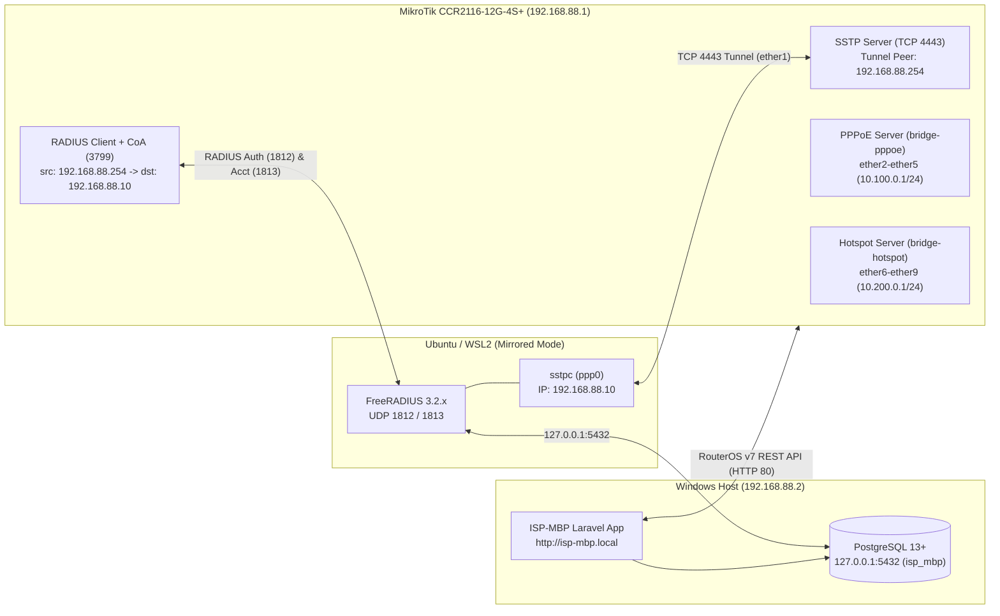

# MikroTik RouterOS v7 & Ubuntu FreeRADIUS Complete Configuration Guide

This guide covers the complete end-to-end setup from a clean **Ubuntu 22.04 / 24.04 (or WSL2 Ubuntu)** installation and a factory-default **MikroTik RouterOS v7** router (`CCR2116-12G-4S+` or any RouterOS v7 device) to full integration with the **ISP Management & Billing Platform (ISP-MBP)**.

---

## 1. Network & AAA Architecture



| Component | Interface / Service | IP Address / Port | Purpose |
| :--- | :--- | :--- | :--- |
| **MikroTik Router** | `ether1` (Management) | `192.168.88.1/24` | REST API (`80`), WinBox (`8291`), SSTP (`4443`) |
| **Windows PC** | USB/LAN (`Ethernet 2`) | `192.168.88.2/24` | Reaches MikroTik `192.168.88.1` (no default gateway) |
| **PostgreSQL DB** | Windows Host Service | `127.0.0.1:5432` | Shared `isp_mbp` database for Laravel & FreeRADIUS |
| **WSL2 Ubuntu** | `ppp0` (SSTP Bridge) | `192.168.88.10/32` | Dedicated router-assigned IP for FreeRADIUS (`1812`/`1813`) |
| **MikroTik Tunnel Peer** | `<sstp-wsl-freeradius>` | `192.168.88.254/32` | Router's RADIUS `src-address` inside the tunnel |
| **PPPoE Subscribers** | `bridge-pppoe` (`ether2`–`5`) | `10.100.0.1/24` | Pool `10.100.0.10`–`10.100.0.250` |
| **Hotspot Subscribers** | `bridge-hotspot` (`ether6`–`9`) | `10.200.0.1/24` | Pool `10.200.0.10`–`10.200.0.250` |

---

## 2. Ubuntu / WSL2: `apt` Packages Installation

Run the following commands inside Ubuntu (or from PowerShell via `wsl -u root`) to install **FreeRADIUS**, the **FreeRADIUS PostgreSQL driver**, **PostgreSQL client tools**, and the **SSTP/PPP tunnel client**:

```bash
sudo apt-get update
sudo DEBIAN_FRONTEND=noninteractive apt-get install -y \
    freeradius \
    freeradius-postgresql \
    freeradius-utils \
    postgresql-client \
    ppp \
    sstp-client \
    iproute2 \
    iputils-ping \
    curl \
    netcat-openbsd
```

> [!TIP]
> On WSL2, installing `sstp-client` may pull `NetworkManager` and `ModemManager` as recommended packages. Disable them so they do not interfere with WSL2 interfaces:
> ```bash
> sudo systemctl disable --now NetworkManager ModemManager wpa_supplicant 2>/dev/null || true
> ```

---

## 3. WSL2 Mirrored Networking Configuration (Windows Host)

If FreeRADIUS runs inside **WSL2** on Windows 11, enable **mirrored networking** so WSL2 shares `127.0.0.1` with Windows PostgreSQL (`127.0.0.1:5432`) and sees your physical network adapters directly.

1. Create or edit `C:\Users\<YourWindowsUser>\.wslconfig`:
   ```ini
   [wsl2]
   networkingMode=mirrored
   dnsTunneling=true
   firewall=false
   autoProxy=true
   ```
2. Restart WSL from PowerShell for the change to take effect:
   ```powershell
   wsl --shutdown
   ```

---

## 4. FreeRADIUS 3.x Configuration on Ubuntu

### Step 4.1: Enable the SQL Module (`mods-available/sql`)
Configure `/etc/freeradius/3.0/mods-available/sql` to use the PostgreSQL driver (`rlm_sql_postgresql`) and connect to the `isp_mbp` database:

```bash
sudo tee /etc/freeradius/3.0/mods-available/sql > /dev/null << 'EOF'
sql {
    driver = "rlm_sql_postgresql"
    dialect = "postgresql"

    server = "127.0.0.1"
    port = 5432
    login = "postgres"
    password = "postgres"
    radius_db = "isp_mbp"

    acct_table1 = "radacct"
    acct_table2 = "radacct"
    postauth_table = "radpostauth"
    authcheck_table = "radcheck"
    groupcheck_table = "radgroupcheck"
    authreply_table = "radreply"
    groupreply_table = "radgroupreply"
    usergroup_table = "radusergroup"

    delete_stale_sessions = yes

    pool {
        start = ${thread[pool].start_servers}
        min = ${thread[pool].min_spare_servers}
        max = ${thread[pool].max_servers}
        spare = ${thread[pool].max_spare_servers}
        uses = 0
        retry_delay = 30
        lifetime = 0
        idle_timeout = 60
    }

    read_clients = yes
    client_table = "nas"
    group_attribute = "SQL-Group"

    $INCLUDE ${modconfdir}/${.:name}/main/${dialect}/queries.conf
}
EOF
```

Enable the `sql` module symlink and fix ownership:
```bash
sudo ln -sf /etc/freeradius/3.0/mods-available/sql /etc/freeradius/3.0/mods-enabled/sql
sudo chown -h freerad:freerad /etc/freeradius/3.0/mods-enabled/sql
sudo chown freerad:freerad /etc/freeradius/3.0/mods-available/sql
sudo chmod 640 /etc/freeradius/3.0/mods-available/sql
```

### Step 4.2: Enable `sql` in `/etc/freeradius/3.0/sites-enabled/default`
Ensure `sql` (or `-sql`) is uncommented in the `authorize`, `accounting`, `session`, and `post-auth` sections of `/etc/freeradius/3.0/sites-enabled/default`:
- Under `authorize { ... }`: include `sql`
- Under `accounting { ... }`: include `sql`
- Under `session { ... }`: include `sql`
- Under `post-auth { ... }`: include `sql` (and inside `Post-Auth-Type REJECT { sql }`)

### Step 4.3: Configure Fallback NAS Clients (`/etc/freeradius/3.0/clients.conf`)
Even though `read_clients = yes` loads NAS routers from the PostgreSQL `nas` table, add the `192.168.88.0/24` management subnet to `/etc/freeradius/3.0/clients.conf` so FreeRADIUS always accepts requests from the router immediately:

```bash
sudo tee -a /etc/freeradius/3.0/clients.conf > /dev/null << 'EOF'

client mikrotik_lan {
    ipaddr = 192.168.88.0/24
    secret = testing123
    shortname = mikrotik-ccr2116
    nas_type = other
}
EOF
```

### Step 4.4: Validate & Restart FreeRADIUS
```bash
sudo freeradius -Cx
sudo systemctl enable freeradius
sudo systemctl restart freeradius
```

---

## 5. MikroTik RouterOS v7 Complete Configuration

Run the following RouterOS CLI commands in **WinBox -> New Terminal**, SSH, or MAC-Telnet on a fresh MikroTik router:

```routeros
# 1. System Identity & Clock
/system identity set name="ISP-MBP-CCR2116-CORE"
/system clock set time-zone-autodetect=no time-zone-name="Africa/Lagos"

# 2. Management Interface (ether1) & DHCP without Default Gateway (preserves PC Wi-Fi)
/ip address add address=192.168.88.1/24 interface=ether1 comment="ISP-MBP Management Network"
/ip pool add name=mgmt-pool ranges=192.168.88.10-192.168.88.50
/ip dhcp-server network add address=192.168.88.0/24 netmask=24 dns-none=yes comment="No Gateway so PC keeps Wi-Fi Internet"
/ip dhcp-server add name=dhcp-mgmt interface=ether1 address-pool=mgmt-pool disabled=no

# 3. Enable RouterOS REST API (HTTP Port 80) & WinBox
/ip service set www disabled=no port=80
/ip service set api disabled=no port=8728
/ip service set winbox disabled=no port=8291

# 4. PPPoE Subscriber Access Network (bridge-pppoe: ether2 - ether5)
/interface bridge add name=bridge-pppoe comment="ISP-MBP PPPoE Subscribers"
/interface bridge port add bridge=bridge-pppoe interface=ether2
/interface bridge port add bridge=bridge-pppoe interface=ether3
/interface bridge port add bridge=bridge-pppoe interface=ether4
/interface bridge port add bridge=bridge-pppoe interface=ether5
/ip address add address=10.100.0.1/24 interface=bridge-pppoe
/ip pool add name=pppoe-pool ranges=10.100.0.10-10.100.0.250
/ppp profile set default local-address=10.100.0.1 remote-address=pppoe-pool
/ppp profile add name=pppoe-default local-address=10.100.0.1 remote-address=pppoe-pool dns-server=8.8.8.8,1.1.1.1
/interface pppoe-server server add service-name="ISP-MBP-PPPoE" interface=bridge-pppoe default-profile=pppoe-default authentication=pap,chap,mschap1,mschap2 one-session-per-host=yes disabled=no
/ppp aaa set use-radius=yes accounting=yes interim-update=5m

# 5. Hotspot Subscriber Network (bridge-hotspot: ether6 - ether9)
/interface bridge add name=bridge-hotspot comment="ISP-MBP Hotspot Subscribers"
/interface bridge port add bridge=bridge-hotspot interface=ether6
/interface bridge port add bridge=bridge-hotspot interface=ether7
/interface bridge port add bridge=bridge-hotspot interface=ether8
/interface bridge port add bridge=bridge-hotspot interface=ether9
/ip address add address=10.200.0.1/24 interface=bridge-hotspot
/ip pool add name=hotspot-pool ranges=10.200.0.10-10.200.0.250
/ip dhcp-server network add address=10.200.0.0/24 gateway=10.200.0.1 dns-server=8.8.8.8,1.1.1.1
/ip dhcp-server add name=dhcp-hotspot interface=bridge-hotspot address-pool=hotspot-pool disabled=no
/ip hotspot profile add name=hsprof-ispmbp hotspot-address=10.200.0.1 login-by=http-chap,http-pap,cookie use-radius=yes radius-accounting=yes radius-interim-update=5m
/ip hotspot add name=Hotspot-ISPMBP interface=bridge-hotspot address-pool=hotspot-pool profile=hsprof-ispmbp disabled=no

# 6. NAT Masquerade for Subscriber Subnets
/ip firewall nat add chain=srcnat src-address=10.100.0.0/24 action=masquerade comment="ISP-MBP PPPoE NAT"
/ip firewall nat add chain=srcnat src-address=10.200.0.0/24 action=masquerade comment="ISP-MBP Hotspot NAT"

# 7. SSTP Server on Port 4443 (Bridges WSL2 Ubuntu to Router IP 192.168.88.10)
/certificate add name=sstp-cert common-name=192.168.88.1 key-usage=digital-signature,key-encipherment,tls-server,key-cert-sign,crl-sign
/certificate sign sstp-cert
/interface sstp-server server set enabled=yes certificate=sstp-cert port=4443 authentication=pap,chap,mschap1,mschap2
/ppp secret add name=wsl-freeradius password=password service=sstp local-address=192.168.88.254 remote-address=192.168.88.10 comment="WSL2 Ubuntu FreeRADIUS Bridge"

# 8. RADIUS Client & CoA (Change of Authorization / Disconnect)
/radius add service=ppp,hotspot,login address=192.168.88.10 src-address=192.168.88.254 secret=testing123 authentication-port=1812 accounting-port=1813 timeout=3s comment="WSL2 Ubuntu FreeRADIUS"
/radius incoming set accept=yes port=3799
```

> [!IMPORTANT]
> Notice why `local-address=192.168.88.254` and `remote-address=192.168.88.10` are used on the `wsl-freeradius` PPP secret:
> Because `sstpc` connects over TCP to `192.168.88.1:4443` via `eth0`, setting the PPP tunnel peer to `192.168.88.254` prevents `pppd` from overriding the route to `192.168.88.1` inside `ppp0` (avoiding a tunnel routing loop).

---

## 6. Persistent Ubuntu-to-MikroTik SSTP Bridge (`mikrotik-sstp.service`)

To ensure WSL2 Ubuntu automatically obtains **`192.168.88.10`** (`ppp0`) from the MikroTik router on boot and reconnects if the cable is unplugged, create `/etc/systemd/system/mikrotik-sstp.service` in Ubuntu:

```bash
sudo tee /etc/systemd/system/mikrotik-sstp.service > /dev/null << 'EOF'
[Unit]
Description=MikroTik SSTP Bridge for WSL2 FreeRADIUS
After=network.target
Before=freeradius.service

[Service]
Type=simple
ExecStart=/usr/sbin/sstpc --log-stderr --cert-warn --user wsl-freeradius --password password 192.168.88.1:4443 noauth nodefaultroute nopcomp noaccomp nobsdcomp nodeflate
Restart=always
RestartSec=3

[Install]
WantedBy=multi-user.target
EOF

sudo systemctl daemon-reload
sudo systemctl enable --now mikrotik-sstp.service
sudo systemctl restart freeradius.service
```

Verify the `ppp0` interface and ping the router peer (`192.168.88.254`):
```bash
ip -4 addr show ppp0
ping -c 3 192.168.88.254
```

---

## 7. Laravel ISP-MBP `.env` & Fresh Migration Deployment

### Step 7.1: Configure [`.env`](file:///c:/wamp64/www/isp-mbp/.env)
Ensure the database, FreeRADIUS NAS, and MikroTik variables are set in [`.env`](file:///c:/wamp64/www/isp-mbp/.env):

```dotenv
APP_NAME="ISP Management Platform"
APP_ENV=local
APP_KEY=base64:jVhYxHDGWJaYLr2ZesdmfJ3gPotkr1tkQ7khHFP5y5Q=
APP_DEBUG=true
APP_TIMEZONE=UTC
APP_URL=http://isp-mbp.local

# Shared PostgreSQL Database (Laravel + FreeRADIUS)
DB_CONNECTION=pgsql
DB_HOST=127.0.0.1
DB_PORT=5432
DB_DATABASE=isp_mbp
DB_USERNAME=postgres
DB_PASSWORD=postgres

# FreeRADIUS & NAS Configuration
RADIUS_SERVER_IP=192.168.88.10
RADIUS_AUTH_PORT=1812
RADIUS_ACCT_PORT=1813
RADIUS_COA_PORT=3799
RADIUS_DEFAULT_NAS_IP=192.168.88.1
RADIUS_TUNNEL_NAS_IP=192.168.88.254
RADIUS_DEFAULT_NAS_SHORTNAME=ISP-MBP-CCR2116-CORE
RADIUS_DEFAULT_NAS_SECRET=testing123

# Default MikroTik RouterOS Edge Device
MIKROTIK_DEFAULT_HOST=192.168.88.1
MIKROTIK_DEFAULT_USERNAME=admin
MIKROTIK_DEFAULT_PASSWORD=password
MIKROTIK_DEFAULT_WEB_PORT=80
MIKROTIK_DEFAULT_API_PORT=8728
MIKROTIK_DEFAULT_SSH_PORT=22
MIKROTIK_DEFAULT_MAC=04:F4:1C:E6:A9:ED
```

### Step 7.2: Run Migrations & Seeders
When you run `php artisan migrate` (or `php artisan migrate:fresh --seed`), migration [`2026_11_14_163851_deploy_packages_and_nas_to_freeradius.php`](file:///c:/wamp64/www/isp-mbp/database/migrations/2026_11_14_163851_deploy_packages_and_nas_to_freeradius.php) automatically:
1. Creates all FreeRADIUS SQL tables (`radcheck`, `radreply`, `radgroupcheck`, `radgroupreply`, `radusergroup`, `radacct`, `radpostauth`, `nas`, `nasreload`).
2. Deploys the 8 ISP packages (`PKG-HOME-5M`, `PKG-HOME-10M`, `PKG-HOME-20M`, `PKG-BIZ-50M`, `PKG-CORP-100M`, `PKG-HS-1H`, `PKG-HS-24H`, `PKG-HS-7D`) into `packages`, `radgroupreply`, and `radgroupcheck`.
3. Registers `192.168.88.1` and `192.168.88.254` in `nas`.

```powershell
php artisan migrate:fresh --seed
wsl -u root -e systemctl restart freeradius.service
```

---

## 8. Verification & Troubleshooting Commands

### 1. Test FreeRADIUS Locally in Ubuntu (`radtest`)
```bash
wsl -u root -e radtest cust_001001 Radius123! 127.0.0.1 0 testing123
```
Expected output includes `Received Access-Accept` and `Mikrotik-Rate-Limit = "5M/10M 7680k/15M 3840k/8M 25/25"`.

### 2. Inspect Deployed FreeRADIUS Packages in PostgreSQL
```sql
SELECT groupname, attribute, op, value FROM radgroupreply ORDER BY groupname, attribute;
```

### 3. Check MikroTik RADIUS Monitor
In WinBox (`Radius -> double-click server -> Status`) or RouterOS CLI:
```routeros
/radius monitor 0 once
```
Confirm `accepts > 0` and `bad-replies: 0`.
